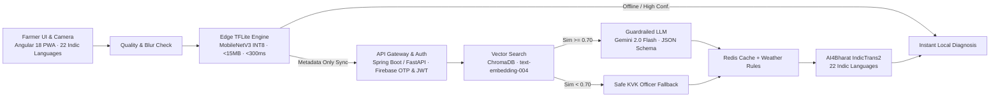

# AgroConnect PWA

[Java](https://www.google.com/search?q=https%3A%2F%2Fopenjdk.org%2F) [Spring Boot](https://www.google.com/search?q=https%3A%2F%2Fspring.io%2Fprojects%2Fspring-boot) [Angular](https://www.google.com/search?q=https%3A%2F%2Fangular.dev%2F) [TFLite](https://www.google.com/search?q=https%3A%2F%2Fwww.tensorflow.org%2Flite) [RAG](https://www.google.com/search?q=https%3A%2F%2Fgithub.com%2Fsaishchaskar%2Fagroconnect-pwa)

**AgroConnect PWA** is an offline-first, AI-driven crop disease management platform built for Indian farmers and agricultural stakeholders. It pairs **on-device edge vision (<300ms, <15 MB)** with a **guardrailed Cloud RAG pipeline** and **22 Indic language localization** to deliver safe, weather-aware remediation guidance even under unstable rural connectivity.

---

## Why AgroConnect? (Field Survey Findings)

Field requirements gathered from community surveys highlight why an offline-first, vernacular, and guardrail-backed architecture is essential:

| Key Field Barrier | Farmers Affected | Most Requested Feature | Priority Rating |
| :--- | :--- | :--- | :--- |
| Unstable Field Internet | **82%** | Local Language Audio / Text | **91%** |
| English UI Barrier | **76%** | Offline Leaf Scan | **88%** |
| Delayed Expert Access | **74%** | Weather Spray Alerts | **84%** |
| Unsure Pesticide Dosage | **68%** | Organic-First Remedies | **79%** |


---

## System Architecture

AgroConnect uses a **two-layer hybrid architecture** so leaf diagnosis works offline in the field while verified agronomy advisories sync when connectivity returns:

1. **On-Device Edge Layer (Offline-First PWA / Mobile):**
   - **Guided Capture & Quality Gate:** Validates lighting, focus, and leaf visibility before inference.
   - **Edge TFLite Engine:** Quantized **MobileNetV3-Large / EfficientNet-Lite0 (INT8, <15 MB)** trained across **450+ Indian crop disease and pest classes**, delivering **<300ms** local diagnosis with **<2% accuracy drop** and **100% farmer image privacy** (metadata-only sync).
2. **Cloud Intelligence & Guardrailed RAG Layer:**
   - **API Gateway & Auth:** Java 21 / Spring Boot 3.x & FastAPI services with Firebase OTP and JWT authentication.
   - **Verified Knowledge Base:** Static manuals (**ICAR, PPQS, DARE, Vikaspedia**) + daily Scrapy/Celery weather & alert crawlers chunked into **500-token** segments with `text-embedding-004` in **ChromaDB / Pinecone**.
   - **Hallucination Prevention:** Enforces a **cosine similarity threshold (≥ 0.70)** for Top-3 retrieval before **Gemini 2.0 Flash / Gemma 2** generates structured JSON advisories; low-confidence queries trigger a **Safe KVK Officer Fallback**.
   - **Semantic Cache & Localization:** **Redis** caches verified advisories (**0.1s** lookup) alongside rain-spray weather rules, and **AI4Bharat IndicTrans2** localizes output into **22 Indic languages**.




---

## Edge Model Optimization & Cloud RAG Pipelines

### On-Device Model Optimization & TFLite Deployment
`Curated Dataset (450+ Classes)` → `224×224 Resize, CLAHE & Augmentation` → `Transfer Learning (MobileNetV3-Large / EfficientNet-Lite0)` → `INT8 Quantization-Aware Training` → `TFLite FlatBuffer (<15 MB)` → `Android NNAPI / GPU Delegate (<300ms)`


### Cloud RAG Ingestion & Hallucination Prevention
`ICAR / PPQS Manuals + Daily Crawler` → `500-Token Chunking & text-embedding-004` → `ChromaDB Top-3 Retrieval` → `Similarity ≥ 0.70 Gate` → `Grounded JSON Advisory (Redis) or KVK Fallback`


---

## Farmer Workflow & Implementation Roadmap

1. **Select Language** from 22 Indic languages.
2. **Capture Leaf & Quality Check** with guided focus/daylight validation.
3. **Offline Edge AI Scan** returns crop + disease confidence in **<300ms**.
4. **Online Advisory Sync** fetches RAG remedies and rain-spray weather alerts.
5. **Actionable Remediation Tabs** present symptoms, organic-first control, chemical dosage, and precautions.
6. **Feedback & Expert Escalation** records ratings and connects to local KVK helplines.

| Farmer Workflow | 4-Phase Agile Roadmap |
| :--- | :--- |
|  |  |

---

## Repository Structure

```text
agroconnect-pwa/
├── frontend/               # Angular 18 PWA + Tailwind CSS + shadcn-inspired UI
├── backend/                # Java 21 + Spring Boot 3.x REST API + Firebase & H2/DB
├── docs/                   # Architecture, project context & diagram assets
├── PROJECT_BOARD.md        # GitHub Projects backlog & sprint workflow
├── GITHUB_ISSUES.md        # Issue backlog
├── CONTRIBUTING.md         # Contributor onboarding & guidelines
└── run.sh                  # Local development runner
```

---

## Local Setup

### Frontend (Angular PWA)
```bash
cd frontend
npm install
npm run start
```

### Backend (Spring Boot)
```bash
cd backend
./mvnw clean install
./mvnw spring-boot:run
```

---

## Contributing & Project Tracking

- See [PROJECT\_BOARD.md](https://www.google.com/search?q=.%2FPROJECT_BOARD.md) for the GitHub Projects board and sprint roadmap.
- See [GITHUB\_ISSUES.md](https://www.google.com/search?q=.%2FGITHUB_ISSUES.md) for open tasks and backlog items.
- See [CONTRIBUTING.md](https://www.google.com/search?q=.%2FCONTRIBUTING.md) for contribution guidelines.
